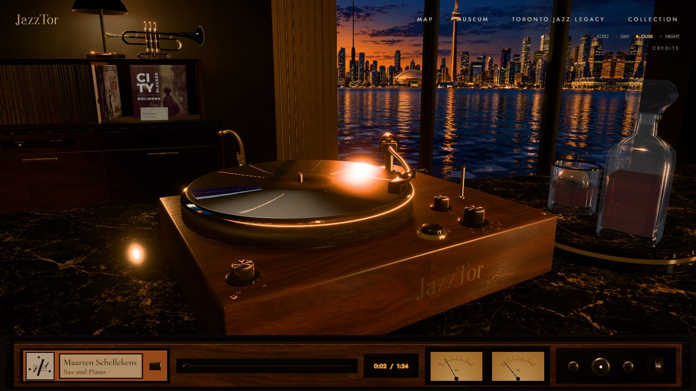
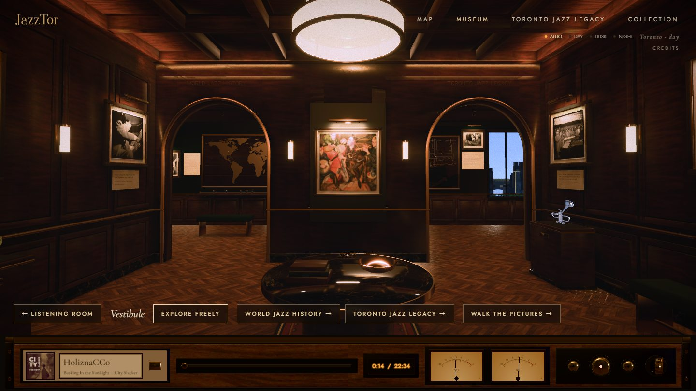
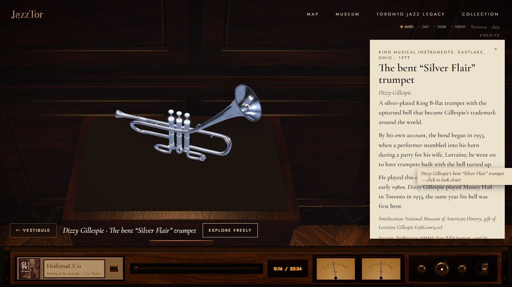
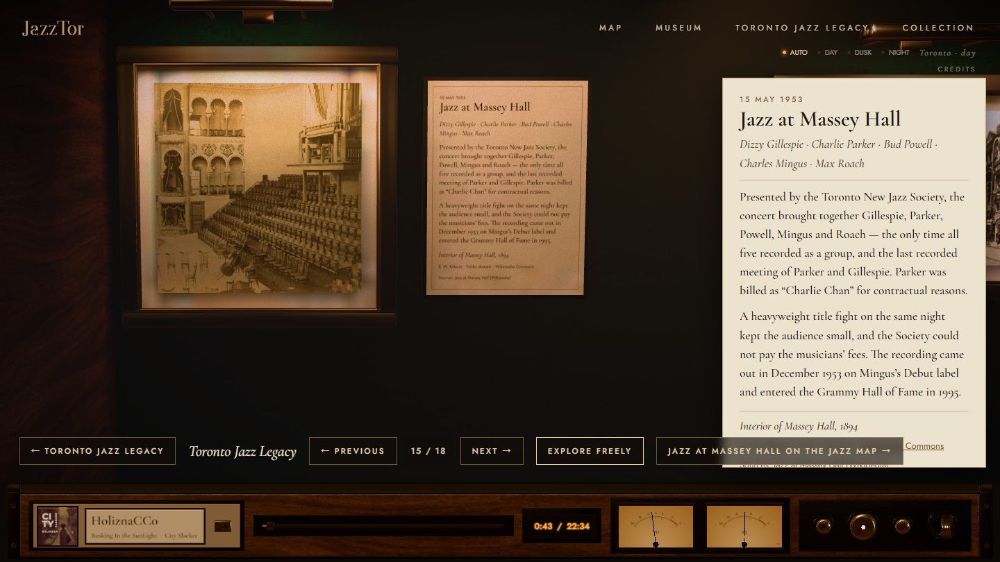
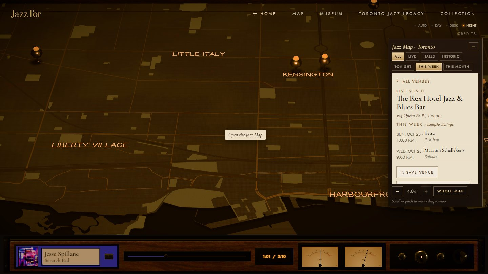

# JazzTor

**A Toronto jazz listening room in the browser.** Put a record on a walnut turntable in a room above Lake Ontario,
follow the city's jazz venues on a map table, and walk through a small museum of jazz history, all in real-time 3D.

**[Open JazzTor →](https://jazztor.vercel.app)** &nbsp;·&nbsp; best on a desktop with Chrome or Edge; the first visit
downloads 30–40 MB of 3D assets before the room appears



## What's inside

| | |
|---|---|
|  |  |
| **The museum.** A vestibule opening onto two wings, World Jazz History and Toronto Jazz Legacy. Follow the guided tour, or walk freely with WASD and sit on the benches. | **Legendary instruments.** Five horns, from Miles Davis to Charlie Parker. Click one to walk up to it and read its story, with sources. |
|  |  |
| **Toronto Jazz Legacy.** The city's jazz history, from the 1953 Massey Hall concert onward, each with a historical photograph and cited wall text. | **The jazz map.** Twelve venues on an engraved map of Toronto built from OpenStreetMap data; zoom, filter and save venues. |

Everywhere else:

- **Thirteen records, 29 tracks**, all CC0 or CC BY from the Free Music Archive.
  - The tracks stream through a working turntable: tonearm, platter speed and VU meters.
- **Day, dusk and night.** The light in the room and the city outside follow Toronto's clock, or a switch.
- **Keyboard and screen reader friendly.** Every 3D object has an HTML control, and the app supports reduced motion.

## How it's built

**The scenes**

- Every model is built by Python scripts in Blender ([`blender/scripts`](blender/scripts)), not modelled by hand. Run headless, they rebuild the scenes from scratch.
- The listening room and the museum are lit in Cycles, and the light is baked into lightmaps.
- Lightmaps exist for both closed and open doors. Fixed light slots are relit live for the time of day.

**Shipping it to the browser**

- [`compress.mjs`](app/scripts/compress.mjs) packs the geometry with Draco and the textures as KTX2/Basis.
- Assets come in three tiers (high, medium, low). The tier is picked from the device's GPU, then stepped down if the frame rate drops.

**The app**

- React 18, react-three-fiber/drei, three.js r169, postprocessing, zustand, Vite.
- Custom shaders handle:
  - the baked-light material and the golden key light on the turntable;
  - the procedural lake;
  - a day/dusk/night sky for the museum windows;
  - a colour grade per space.
- In the museum, a first-person walk uses push-out collision and has seats.

**Testing**

- Playwright scripts drive Microsoft Edge on both the integrated and the dedicated GPU.
- [`verify.mjs`](app/scripts/verify.mjs) runs 62 checks, from the door's handle-latch-swing order to sitting on a bench.
- [`qa.mjs`](app/scripts/qa.mjs) runs 29 checks for load time, map flights and audio streaming. A separate smoke test checks the production build.

## Run it locally

Requires Node 20+.

```bash
cd app
npm ci
npm run sync-assets   # Draco/Basis decoders and album art into public/
npm run dev           # add ?quality=high|medium|low to force a tier
```

Rebuilding the 3D assets also needs Blender 5.x. The steps are in [`app/README.md`](app/README.md).

## Credits and licences

**Code:** MIT ([LICENSE](LICENSE)).

**Assets.** The assets are not covered by the MIT licence. Each keeps its own terms:

- **Music:** CC0 1.0, CC BY 3.0 or CC BY 4.0, checked track by track. Each track's source and licence are listed in the in-app
  Credits and in [`audio/licenses`](audio/licenses).
- **Museum pictures:** 20 photographs, posters and a painting, all public domain, CC0 or CC BY, from Wikimedia Commons and
  Standard Ebooks. They are credited in the app, with each file's Commons record kept in [`assets/museum/licences`](assets/museum/licences).
- **Map:** © OpenStreetMap contributors (ODbL).
- **Window view and room surfaces:** the Toronto skyline outside the listening-room window and the walnut, brass and marble surfaces are
  **AI-generated images** (ChatGPT) made for this project. They are not photographs. See
  [`assets/environment/licenses`](assets/environment/licenses).
- **Original work:** the 3D models, the JazzTor wordmark and the interface design are original work and are not licensed for reuse.

Historical text in the museum cites its sources on every card. Venue listings shown on the map are marked as samples.
